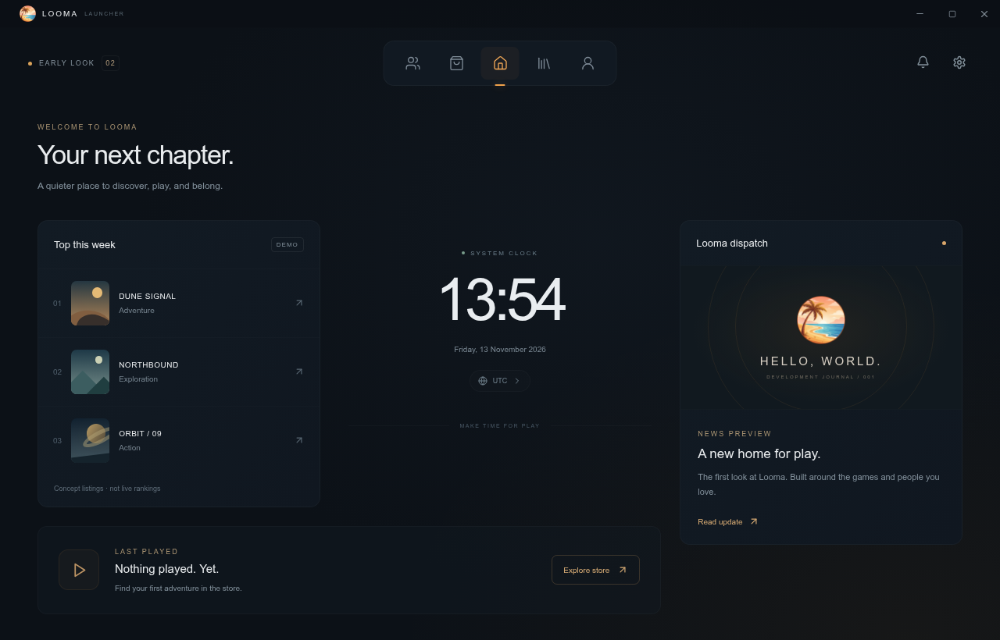

# Looma Launcher

**All Your Games. One Place.**

A Windows game launcher in early development, built with **Tauri 2, React, TypeScript and Rust**. Looma aims to make discovering, managing and playing games simpler for Iranian and international players.

> **Current milestone: UI preview 0.2.** This is a working interface prototype, not a production launcher. Game listings and news are sample content. Downloads, installation, game execution, accounts, chat and payments are not connected. A Windows installer has not yet been built or tested.



## Try the preview

Download [`Looma-preview.html`](Looma-preview.html) using GitHub's **Download raw file** button, then open the downloaded file in a recent Chrome or Edge browser. JavaScript, CSS and artwork are embedded; no installation or CDN is required. GitHub's file page itself does not run the preview.

The startup progress meter is a timed demonstration, not actual download/loading progress. Browser window controls do not control desktop windows.

## What works today

- Logo-first startup, pixel-text animation, progress beneath the title and a Welcome transition.
- Centered icon navigation with optional delayed auto-hide.
- Home with sample weekly games/news, a system clock and an empty last-played state.
- Initial Store, Library, Friends, Account and Settings interfaces.
- English/Persian selection, RTL text while retaining the page layout, timezone preferences and reduced-motion controls.
- Local settings persistence through browser localStorage. SQLite is planned, not integrated.

Native Windows behavior and RAM/CPU usage have **not** been verified. Tauri is intended to help keep the app lightweight; no measured performance advantage is claimed yet.

## Run from source

Install Node.js LTS, then:

```bash
npm ci
npm run dev
```

Create the web build and standalone HTML:

```bash
npm run build
```

For Windows development, install Rust stable, Microsoft C++ Build Tools with the Desktop development with C++ workload/Windows SDK, and WebView2 Runtime:

```bash
npm run tauri dev
# Build an installer on a suitably configured Windows machine:
npm run tauri build
```

See [build notes and limitations](docs/BUILD.md). No Windows executable is included.

## Follow development

- [Roadmap](ROADMAP.md): planned milestones and acceptance criteria.
- [Changelog](CHANGELOG.md): changes delivered in each preview.
- [Issues](https://github.com/YeloBoi/Looma-Launcher/issues): bugs and feature requests.
- [Contributing](CONTRIBUTING.md): how to give useful feedback.

Star the repository to bookmark the project. Use **Watch → Custom → Releases** to follow future published releases. There is no fixed launch date. The immediate goal is a tested Windows app that can download, install, launch and update **one legally distributable free game** before expanding the platform.

## Project structure

```text
src/main.tsx           Main interface and local preferences
src/Startup.tsx        Startup animation
src/style.css          Interface styles
src-tauri/             Native Tauri application configuration
scripts/standalone.mjs Standalone HTML generator
docs/                  Build notes, screenshots and original vision
```

## License and acknowledgements

A project license has not yet been chosen. Public source visibility does not by itself grant an open-source license. Dependencies retain their own licenses; redistribution rights for artwork and games must be reviewed before a release.

The project is developed with AI assistance, including OpenAI ChatGPT and Anthropic Claude, as acknowledged in the [original project introduction](docs/ORIGINAL-VISION.md).

---

## فارسی — لانچر لوما

**تمام بازی‌های شما، در یک مکان.**

لوما یک لانچر ویندوز در مرحلهٔ توسعهٔ اولیه است؛ با Tauri 2، React، TypeScript و Rust و با هدف ارائهٔ تجربه‌ای ساده برای کاربران ایرانی و بین‌المللی ساخته می‌شود.

### وضعیت واقعی پروژه

نسخهٔ فعلی **پیش‌نمایش رابط ۰٫۲** است، نه لانچر نهایی. صفحهٔ شروع، منوی بالا، خانه و صفحات اولیه ساخته شده‌اند. زبان فارسی/انگلیسی، ساعت، منطقهٔ زمانی و ذخیرهٔ تنظیمات محلی قابل‌آزمایش‌اند.

**دانلود و نصب بازی، اجرای بازی، حساب کاربری، چت و پرداخت هنوز متصل نیستند.** بازی‌ها و خبرها نمونه‌اند؛ نوار شروع نمایشی است. نصب‌کنندهٔ ویندوز و مصرف حافظه هنوز آزمایش نشده‌اند.

### مشاهدهٔ نمونه

فایل [Looma-preview.html](Looma-preview.html) را با دکمهٔ Download raw file دریافت و در Chrome یا Edge باز کنید. نصب لازم نیست. صفحهٔ نمایش کد در GitHub، خود نمونه را اجرا نمی‌کند.

### مسیر توسعه

۱. تثبیت ظاهر و فارسی‌سازی
۲. ساخت و تست نسخهٔ ویندوز
۳. دانلود، نصب، اجرا و به‌روزرسانی یک بازی رایگان مجاز
۴. اتصال سرور، حساب و محتوای واقعی
۵. پنل مدیریت و بررسی انتشار بازی‌ها
۶. تست محدود و انتشار اولیه
۷. امکانات دوستان و چت پس از پایدارشدن هسته

جزئیات در [رودمپ](ROADMAP.md) آمده است. تاریخ انتشار قطعی تعیین نشده؛ اولویت با بازی‌های رایگان است و پرداخت فعلاً غیرفعال می‌ماند. برای پیگیری، مخزن را Star کنید یا اعلان انتشارها را از Watch فعال کنید.

مجوز پروژه هنوز انتخاب نشده است؛ عمومی‌بودن سورس به‌تنهایی به معنی صدور مجوز متن‌باز نیست.
